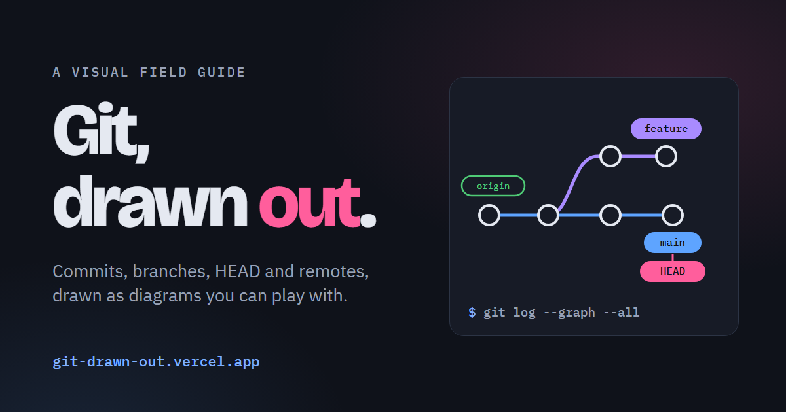

<p align="center">
  <a href="https://git-drawn-out.vercel.app"></a>
</p>

<h1 align="center">Git, Drawn Out</h1>

<p align="center">
  A visual field guide to Git. Commits, branches, HEAD, remotes and stash, drawn as diagrams you can play with.
  <br><br>
  <a href="https://git-drawn-out.vercel.app"><b>Live demo →</b></a>
</p>

<p align="center">
  
  
  
</p>

## What's inside

- **Mental model.** Commits, branches and HEAD as a few kinds of pointers.
- **Playground.** Twelve scenarios you step through while the commit graph changes, from basics to force pushes. Predict mode asks what each command will change before you see it. Click any commit to see its names (`HEAD~2`, `main^2`), pick two refs to highlight `A..B`, and copy a link to any step (`#play=rebase/2`).
- **Merge vs rebase.** The same history combined both ways, side by side.
- **Three areas.** Working folder, staging area and commits, with two files so you can stage one and not the other.
- **Under the hood.** What actually lives in `.git`, and a live blob-hash calculator.
- **Concepts.** Reset and reflog, detached HEAD, three-way merges, plus a conflict you resolve yourself.
- **Oh no, I….** Fixes for common mistakes, each linked to the playground step that shows it.
- **Commands.** Searchable and filterable by effect, with copy buttons, an old-`checkout`-to-`switch`/`restore` table, settings worth changing once, and a printable cheat sheet.
- **Glossary.** Definitions that also appear when you hover underlined words.

The graph colors carry meaning: **blue** = branch, **pink** = HEAD, **green** = remote, **amber** = stash.

## Why this exists

I made this guide for myself while learning Git, because diagrams made it click in a way the docs didn't. Later I thought, why not make it public? If it helps you too, that's a win.

## Run locally

It's a single static page with no build step. Clone the repo and open `index.html` in a browser.

```bash
git clone https://github.com/chaudharyShub/git-drawn-out.git
cd git-drawn-out
```

## Project structure

```
git-drawn-out/
├── index.html            # the guide
├── 404.html              # "Detached HEAD" not-found page
├── css/
│   ├── tokens.css        # colors (light + dark), fonts — shared by every page
│   ├── main.css          # styles for the guide
│   └── 404.css           # styles for the 404 page
├── js/
│   ├── main.js           # commit-graph renderer, playground, demos and command list
│   ├── page.js           # conflict demo, glossary tooltips, sticky nav, printing
│   ├── theme.js          # light/dark toggle (loaded in <head> so there's no flash)
│   └── insights.js       # analytics, skipped on the owner's own browsers
├── assets/
│   ├── icons/            # favicon.svg, favicon-32, apple-touch-icon, 192/512 app icons
│   └── images/           # og-image.png (social preview)
├── design/               # HTML sources for the images (not deployed)
├── docs/                 # notes, e.g. the shared Shubham Works footer (not deployed)
├── site.webmanifest      # app name and icons for "Add to Home Screen"
├── robots.txt
├── sitemap.xml
├── vercel.json           # clean URLs and cache headers
└── LICENSE
```

## Deploy

Hosted on [Vercel](https://vercel.com) as a static site. Every push to `main` deploys to production, and other branches get preview URLs.

## Made by

Git, Drawn Out is a **Shubham Works** project, made by [Shubham Chaudhary](https://shubhamworks.vercel.app/).

Also:

- [CloudPrep](https://aws-cloud-prepare.vercel.app/): practice exams for three AWS certifications
- [Frontend Interview Prep](https://frontend-interview-prepare.vercel.app/): frontend interview questions with answers
- [All projects](https://shubhamworks.vercel.app/projects)

## License

[MIT](LICENSE) © Shubham Chaudhary
